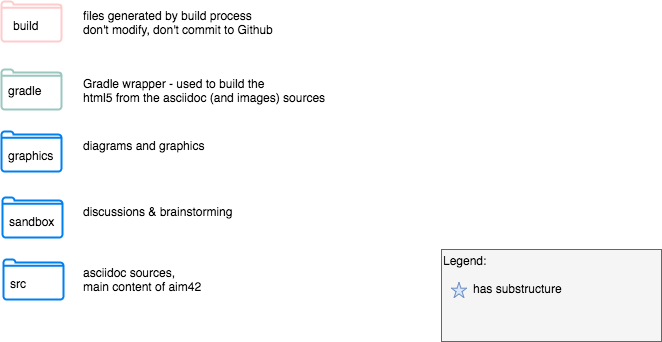
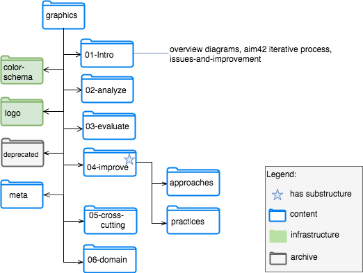

#  Architecture Improvement Method

> **This repository is archived.** The aim42 method reference has moved into the website:
> read it at [aim42.org](https://aim42.org), contribute via [aim42/aim42.org-site](https://github.com/aim42/aim42.org-site)
> (all open issues have been transferred there).

## Software Evolution, Maintenance and Improvement - Done Right!

[aim42](http://aim42.org) is collection of practices and patterns to support software evolution, maintenance, evolution and improvement of software systems.

aim42 divides change activities in three distinct phases:

* **analyze** issues, risks, problems, symptoms and technical debt within software (and their organisations).
* **evaluate** those issues, identify root-causes and remedies, prioritize.
* **improve** by applying appropriate remedies, strategies and tactics.

aim42 has been founded by [Gernot Starke](http://gernotstarke.de), is supported by [innoQ Deutschland GmbH](http://innoq.com) and is licenced under the
liberal [Creative Commons Sharealike 4.0](http://creativecommons.org/licenses/by-sa/4.0) licence.

### Learn more

* [aim42.org](https://aim42.org) contains the complete method reference.

### Contribute

* found mistakes or ommissions: create an [issue](https://github.com/aim42/aim42.org-site/issues)
* have ideas: fork the [repository](https://github.com/aim42/aim42.org-site) and create a pull request. You need a basic understanding of [Git](http://git-scm.com) for this.

We write the content in [AsciiDoc](http://asciidoctor.org/docs/asciidoc-syntax-quick-reference/) and
build with [Gradle](https://gradle.org).

As of September 2017, we removed the AsciiDoc help from the aim42 guide,
you can find it [here](), under the arc42 organization.

## Repository Organization

#### Top-Level

(Original drawn with [draw.io](https://draw.io), source located in /graphics/meta/aim42-repo-structure.xml)

#### Graphics

Both diagrams created with (desktop-version of) [draw.io](https://draw.io), source located in /graphics/meta/aim42-repo-structure.xml)
